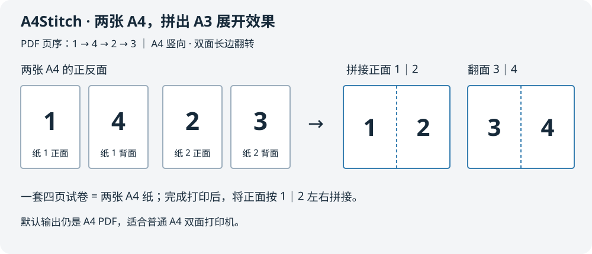

# A4Stitch · A4 拼卷

**把试卷照片和扫描 PDF，整理成 A4 双面打印文件，拼出 A3 展开效果。**

[GitHub](https://github.com/iiccttff/a4-stitch) · [English](README.en.md) · [使用说明](使用说明.md) · [标准流程](docs/标准处理流程.md) · [贡献指南](CONTRIBUTING.md)

A4Stitch 面向使用 A4 双面打印机的家庭与教师。将一套四页试卷整理成 **1 → 4 → 2 → 3** 的 PDF：两张 A4 打印完成后左右拼接，正面是 **1｜2**，背面是 **3｜4**。



## 三步使用

1. 将同一套试卷的照片或扫描 PDF 放入 **待处理试卷**。
2. 双击 **处理试卷.bat**。
3. 在自动打开的 **output/最新结果** 中找到打印 PDF。

**打印设置：A4、竖向、每张 1 页、双面长边翻转、适合可打印区域。**
PDF 已排好页序，打印软件中请使用普通单页打印设置。

| 纸张 | 正面 | 背面 |
|---|---|---|
| 第一张 A4 | 第 1 页 | 第 4 页 |
| 第二张 A4 | 第 2 页 | 第 3 页 |

将正面按第1页在左、第2页在右拼接，整体翻面后得到第3页在左、第4页在右。首次使用某台打印机时可先试印一份，确认翻面方向。

## 功能

- 从左右两页的照片中寻找空白分界并拆页，结合文字投影与页脚识别校正方向。
- 使用 Windows 本地 OCR 识别真实页码，先排序，再生成 A4 拼接页序。
- 支持扫描 PDF；同一个 PDF 中的多套完整四页试卷分别输出。
- 从内容识别年级、科目和标题，自动命名打印文件；不确定的字段不补写。
- 从最终 PDF 渲染画面再次识别页脚，检查页数、尺寸和方向，生成核验预览与结果。
- 自动生成拼接预览与本批压缩包。
- 核验通过的原文件移到 **已处理**；失败输入留在 **待处理试卷**。原文件内容保持不变。
- **最新结果**固定显示本批文件，上一批自动转入**历史结果**。
- 本地处理，无需云端 OCR、API 密钥；准备好环境后可离线运行。

## 环境与安装

目前面向 **Windows x64**，主要适配中文学校试卷。需要 **Python 3.10+**、Windows PowerShell 和可用的 Windows 中文 OCR 语言组件。

1. 下载或克隆源码，解压到本地目录。
2. 双击 **安装依赖.bat**，自动建立工程内的 `.venv`。
3. 双击 **检查环境.bat**，检查依赖、Windows OCR 和工程内 Poppler。
4. 使用 **处理试卷.bat**。

Python 依赖固定在 `app/requirements.txt`。安装器优先使用 `tools/wheels` 中的离线安装包；缺包时需要联网。Poppler 缺失时会从上游 GitHub Windows 发行包恢复到 `tools/poppler`。

本机已验证 Windows x64 / Python 3.14。源码仓库不包含虚拟环境、大型二进制或离线安装包；其他机器首次安装需要联网获取对应依赖。

## 输入怎样命名

**一次一套照片时，原文件无需改名。** 程序通过页脚识别顺序，不使用文件名当页码。

同时处理多套照片时，用字母前缀区分归属：

```text
待处理试卷/
├─ a1.jpg     第一套
├─ a2.jpg     第一套
├─ b1.jpg     第二套
├─ b2.jpg     第二套
└─ 扫描文档.pdf
```

每个 PDF 单独处理，无需改名。自动命名针对输出文件，不会擅自重命名原图。

## 结果在哪里

```text
output/
├─ 最新结果/
│  ├─ 一年级语文_期中测试卷_打印版.pdf
│  ├─ 对应的打印说明、核验结果与核验预览
│  ├─ 本次拼接预览.png
│  └─ 本次打印文件.zip
└─ 历史结果/
   └─ 以前批次的结果
已处理/
└─ 保留原名的原始照片和PDF
```

双击 **打开最新结果.bat** 可再次打开本批文件夹。同名文件自动加序号；空运行或全部失败不会替换上次最新结果。

## 当前边界

- 默认流程针对**一套四页**的试卷，每张照片是左右两页。
- 照片页码不完整时会弹窗核对；扫描 PDF 页码或分套不明确时停止，不猜测。
- PDF 页码重新开始时可分套；不能承诺从任意打乱、混放的多套试卷中可靠推断归属。
- PDF 页面旋转标记、明显拍摄透视、弯曲和倾斜尚未实现完整自动校正。
- 自动核验检查实际页脚、页数、尺寸和方向。**题目边缘是否完整、细线和插图是否清楚，仍应查看预览。**
- 原图低清晰度、遮挡或缺字无法通过放大恢复。
- 这套默认流程使用两张 A4 纸拼接。真正 A3 整张输出是进阶选项，见开发说明。

## 开发

```powershell
.venv\Scripts\python.exe -m unittest discover -s tests -v
.venv\Scripts\python.exe app\setup_local.py --check
.venv\Scripts\python.exe app\exam_print.py --help
```

项目结构、命令行选项见 [开发说明](docs/开发说明.md)。本地回归测试覆盖归档重名保护、失败回滚、核验失败保留输入，以及最新/历史结果轮换。
GitHub Actions 配置已提供；Windows OCR 和真实打印效果需要在本地检查，CI 不替代这两项。

## 开源依赖

图像处理使用 Pillow，PDF 裁切与拼版使用 pypdf，分析渲染使用 pypdfium2，独立渲染复核使用 Poppler，OCR 使用 Windows 自带组件。
详见 [第三方说明](THIRD_PARTY_NOTICES.md)。

## 许可证与贡献

本仓库原创代码和文档采用 [MIT License](LICENSE)。第三方组件遵循各自的许可证。
欢迎提交问题和改进；请使用自行生成或有权分享、已去除个人信息的示例，见 [贡献指南](CONTRIBUTING.md)。
